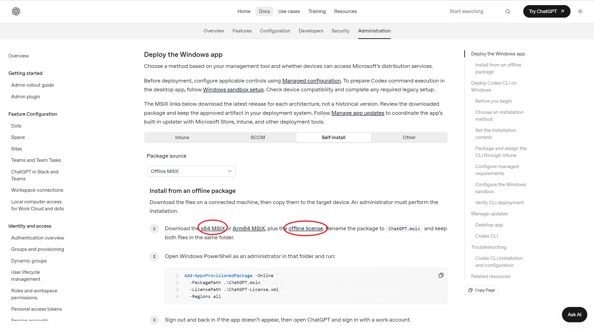

# 如何在没有 Microsoft Store 的 Win10 电脑上安装 ChatGPT 桌面版

我们公司电脑上没有 Microsoft Store，Windows 更新也被禁用了，导致装不了 ChatGPT 桌面版。
但其实 OpenAI 在企业部署文档里提供了官方的离线安装包。
遂写下这篇文章，记录详细步骤和坑点，供大家（包括我自己）参考、复现。

1. 下载安装包和许可证：

离线安装包由两个文件组成：一个 MSIX 安装包，一个许可证文件 ChatGPT-License.xml。

在浏览器地址栏输入：
https://learn.chatgpt.com/docs/enterprise/windows-deployment?deployment=user&user-source=offline
找到 Deploy the Windows app，选 Self-install，把 Package source 下拉框改成 Offline MSIX。
然后找到 Install from an offline package 这一节，点击 x64 MSIX 和 offline license 进行下载。（ARM电脑点 Arm64 MSIX）

于是得到：
ChatGPT-x64.msix
ChatGPT-License.xml

2. 安装：

把这两个文件放进同一个文件夹，然后把 ChatGPT-x64.msix 改名为 ChatGPT.msix。两个文件都要，这是官方要求的。

以管理员身份运行 Windows PowerShell，然后 cd 到刚才的文件夹，输入：
Add-AppxProvisionedPackage -Online -PackagePath .\ChatGPT.msix -LicensePath .\ChatGPT-License.xml -Regions all
这条命令会把 ChatGPT 装给这台电脑上的所有用户。
没报红字就是装好了。

3. 安装成功，在开始菜单里能找到 ChatGPT。

如果哪天上面的网址打不开了，就在 learn.chatgpt.com 里搜 windows deployment 或者 offline MSIX。认准下载地址的域名是 persistent.oaistatic.com，命令以官方页面上写的为准。

关于更新：
它会自己检查更新，只要电脑能访问 persistent.oaistatic.com 就会自动更新。
除非公司防火墙拦了这个域名，它就会一直停在你装的那个版本，此时想更新只能手动更新，再按我上面说的做一遍。
那以前下载的 MSIX 过段时间还能拿来装吗？能装，但装出来的是旧版本。

如果装不上：
报 0x80073D28：没有用管理员身份运行 PowerShell。
报 0x80073CF3：大概率是下错了架构（x64/ARM64），或者已经装过别的版本。
报 0x80073D06：已经装了更新的版本，不用再装了。
报 0x80073CFF 或 0x80073D01：被公司策略拦了。
提示系统不适用、不支持：你电脑版本低于 Win10 2004，装不了 ChatGPT 桌面版。安装包里写死了最低系统版本是 10.0.19041（也就是2004）。
装上了但打不开：企业版、教育版的 Windows 有一条组策略叫“禁用来自 Microsoft Store 的所有应用”，你可以看一下。

参考文献：
OpenAI官方企业部署文档：https://learn.chatgpt.com/docs/enterprise/windows-deployment
OpenAI官方用户文档：https://learn.chatgpt.com/docs/windows/windows-app
Codex并入ChatGPT的官方说明：https://help.openai.com/en/articles/20001276-moving-to-the-new-chatgpt-desktop-app
微软Add-AppxProvisionedPackage文档：https://learn.microsoft.com/en-us/powershell/module/dism/add-appxprovisionedpackage
微软MSIX安装错误码表：https://learn.microsoft.com/en-us/windows/win32/appxpkg/troubleshooting
OpenAI社区帖（Store服务被禁用时直接装MSIX）：https://community.openai.com/t/codex-installer-fails-when-microsoft-store-services-are-disabled-direct-msix-install-works/1386304
